

# CARAVAGGIO
### LIGHT · SHADOW · BLOOD

**An immersive journey through Caravaggio’s paintings, life and contradictions.**

[Explore the interactive prototype](https://www.figma.com/proto/gVNoq7JkoidWp73WNVsCdA/CARAVAGGIO-%E2%80%94-LIGHT---SHADOW---BLOOD-project?node-id=2251-2&p=f&scaling=min-zoom&content-scaling=fixed&page-id=0%3A1&starting-point-node-id=2251%3A2) · [Design & interaction notes](docs/prototype-notes.md) · [Project roadmap](docs/work-plan-2026-2027.md)

**Figma prototype · COMP-2002 Web Development · OPIT**

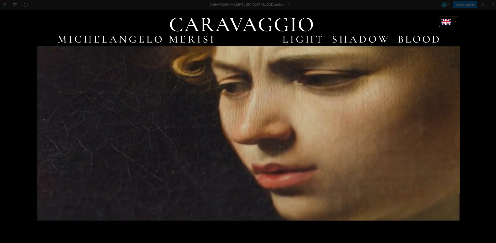

## The experience

A painting first. A detail next. A story when you choose to look closer.

This project explores Caravaggio through three visual chapters: **LIGHT**, **SHADOW** and **BLOOD**. Full paintings establish context; selected details and short anecdotes invite visitors to pause, interpret and discover the person behind the work. Gold helper buttons reveal longer explanations without crowding the gallery.

The experience uses contrasting backgrounds, expressive typography and generous space around the artwork. Visitors move horizontally within each chapter and vertically between chapters.

## Explore the prototype

1. Open the [interactive Figma prototype](https://www.figma.com/proto/gVNoq7JkoidWp73WNVsCdA/CARAVAGGIO-%E2%80%94-LIGHT---SHADOW---BLOOD-project?node-id=2251-2&p=f&scaling=min-zoom&content-scaling=fixed&page-id=0%3A1&starting-point-node-id=2251%3A2) on a desktop browser.
2. Choose a language using the selector on the opening screen.
3. Scroll vertically between chapters and horizontally to explore their paintings and details.
4. Select a gold helper button to focus on an image and its explanation.
5. Close the helper with **×** or a click outside its gold-bordered text panel, within the prototype viewport.

**Current stage: Assessment 1 — interactive prototype.** This repository documents the design and its content. Website implementation, responsive layouts, browser scroll snapping and AWS services belong to later phases.

## How the prototype is built

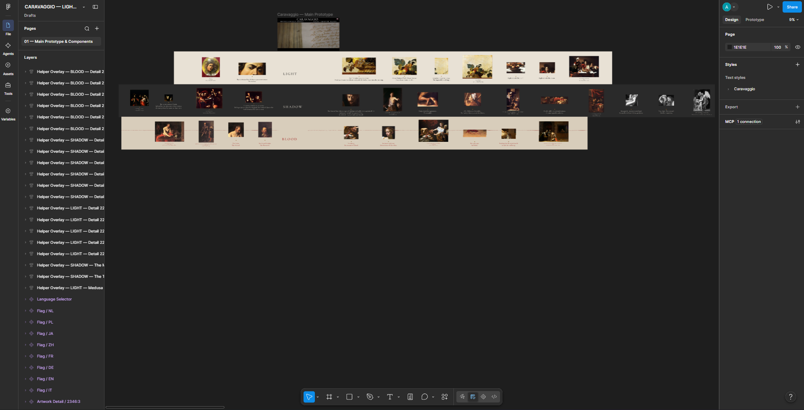

The prototype uses **one vertically scrolling main frame** to connect the opening screen and the three chapters. Each chapter has a **horizontal scrolling viewport** containing one extended frame with its title, artworks, details and captions. This nested structure creates a continuous vertical journey with independent horizontal exploration.

Reusable components, text styles and variables keep controls and presentation consistent. Complete paintings provide title, year and collection/location; selected crops add a short anecdote and a gold button for an optional explanation.

The main technical decisions are:

- **Focused overlays:** opening a helper covers the surrounding gallery and centres the crop and explanation on the chapter background.
- **Explicit close targets:** × and clicks outside the gold-bordered panel dismiss the helper; clicking its text keeps it open.
- **One opening per click:** each live button has one overlay-opening action, preventing stacked copies that require repeated closing clicks.
- **Independent hover feedback:** mouse-enter and mouse-leave events toggle the existing warm reflection through a Boolean variable, without switching component variants.
- **Stored translations:** the selector updates bound text variables for anecdotes; helper opening actions display the corresponding saved language panel. Both follow the same selected language.
- **Language-aware fitting:** font size, wrapping and panel placement accommodate different text lengths and writing systems without rewriting the content.

## Design research: what I took from DATALAND

**[dataland.art](https://dataland.art/), the website of DATALAND, the Museum of AI Arts in Los Angeles, was a direct design reference for this project.** Two aspects particularly appealed to me: the immersive impact of its large opening video and the way partially visible neighbouring content encourages sideways exploration. I adapted both ideas to Caravaggio’s paintings and storytelling.

| Reference | What I liked | How I applied it to Caravaggio |
| --- | --- | --- |
| **Near-full-screen opening video** | Moving imagery dominates the opening view and establishes an atmosphere before visitors begin exploring | A large introductory video occupies most of the opening screen beneath the Caravaggio title, introducing the mood of LIGHT, SHADOW and BLOOD |
| **Neighbouring content visible at the sides** | A central item remains the focus while fragments at the edges reveal that more content is available | Paintings, details and captions remain partly visible beside the central item, inviting horizontal scrolling through each chapter |

### An immersive opening video

The opening video’s **near-full-screen presentation is explicitly inspired by DATALAND**. What I wanted to bring into my project was the feeling of entering an exhibition through moving images. I adapted that presentation to an introductory montage about Caravaggio, with the project title and language selector framing the experience.

| DATALAND — opening video reference | Caravaggio — opening video in the prototype |
| --- | --- |
| 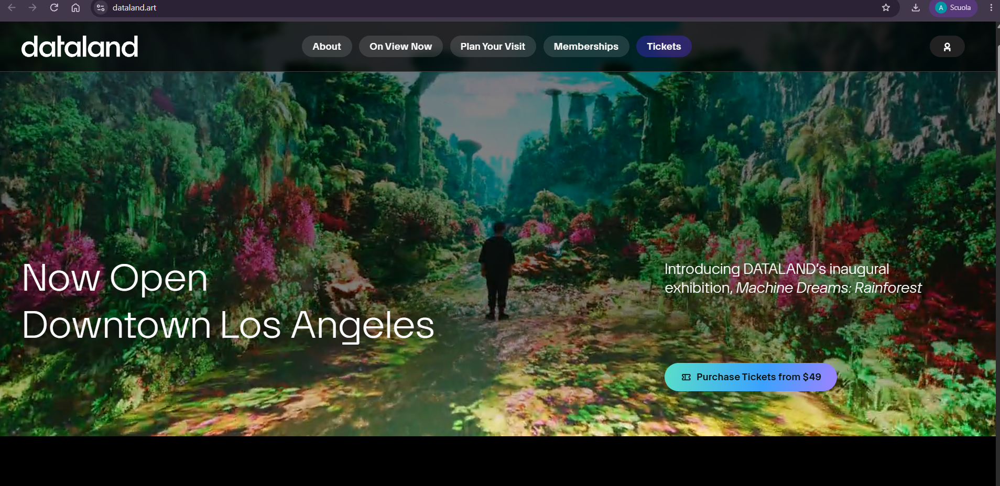 |  |

This reference concerns the **presentation and visual impact of the video**. The source credits for the Caravaggio montage are documented separately in [Credits](docs/credits.md#introductory-audiovisual-material).

### Making horizontal exploration intuitive

Artworks and captions are deliberately **partially visible at the left and right edges** of the gallery. These glimpses show that the composition continues beyond the viewport and invite visitors to scroll sideways. The central detail stays in focus while neighbouring images and text act as navigation cues.

This design choice was inspired by **[dataland.art](https://dataland.art/), the website of DATALAND, the Museum of AI Arts in Los Angeles**. In particular, its presentation of a central item with neighbouring content visible at the sides informed the horizontal exploration in this project.

| Caravaggio prototype — neighbouring artworks visible at the edges | Design reference — dataland.art |
| --- | --- |
| 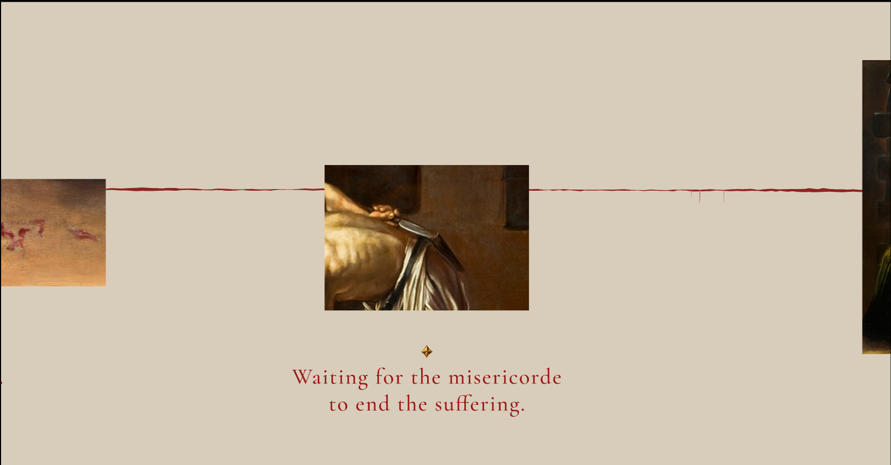 | 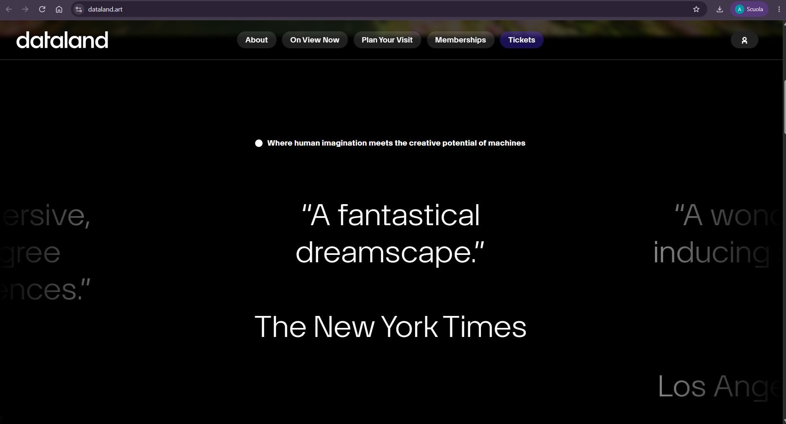 |

The website will also include a **visible horizontal scrollbar** for each gallery, giving visitors an explicit way to discover, control and track horizontal movement. The side previews, scrollbar and planned snap alignment will work together.

[Read the detailed architecture and implementation notes](docs/prototype-notes.md).

## Three chapters

| LIGHT | SHADOW | BLOOD |
| --- | --- | --- |
| Light, matter and the presence of the sacred. | Human imperfection, scandal and the painter’s personal struggles. | Violence, mortality and the search for protection. |
| [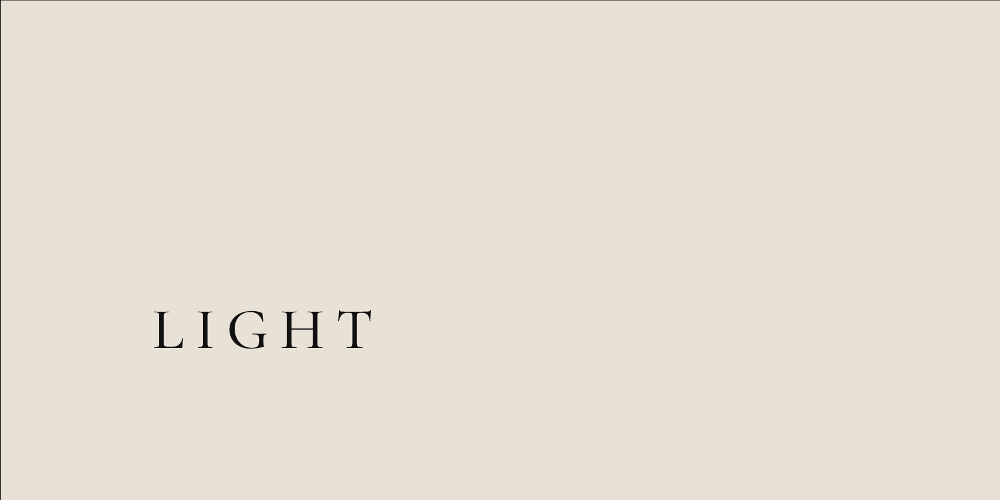](assets/screenshots/light-chapter.png) | [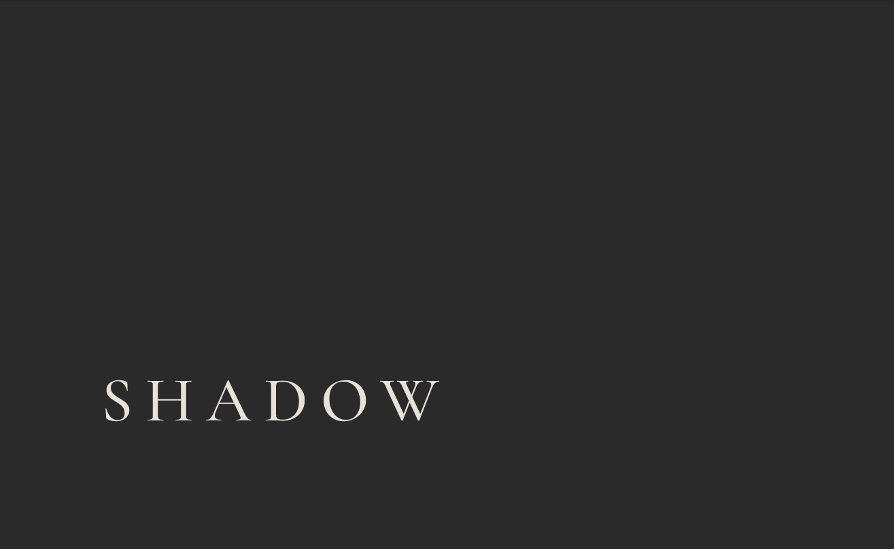](assets/screenshots/shadow-chapter.png) | [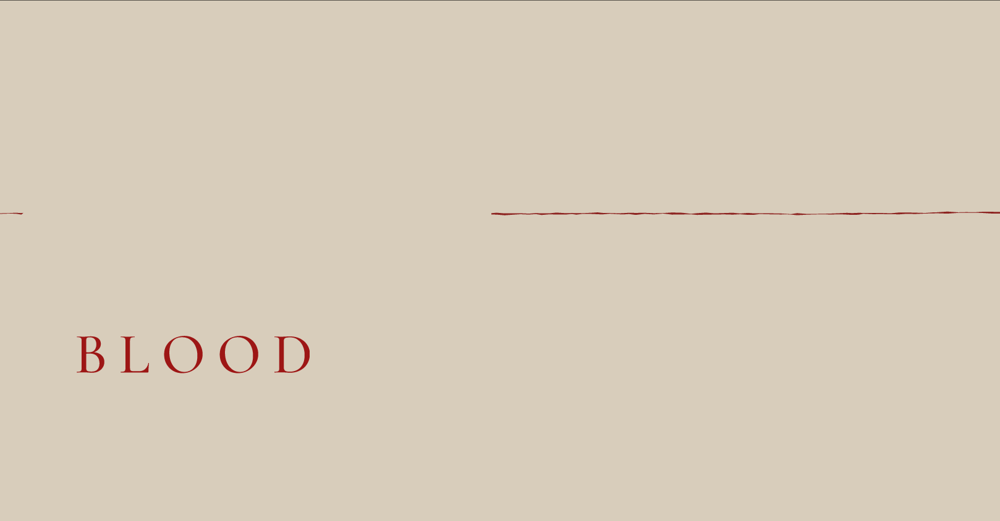](assets/screenshots/blood-chapter.png) |

### Language selection across anecdotes and helpers

The language selector applies to both the **short anecdotes beneath the artwork details** and the **longer explanations opened through the gold helper buttons**. Selecting a language displays the corresponding stored translations throughout the prototype, so visitors can explore both levels of storytelling in their chosen language.

The examples below show anecdotes in Italian and English; the helper screenshots that follow show the longer explanations in Polish, German and Japanese. All eight language versions are saved in Figma, without runtime translation API calls.

| SHADOW — Saint Matthew and the Angel · Italian | BLOOD — Judith Beheading Holofernes · English |
| --- | --- |
| 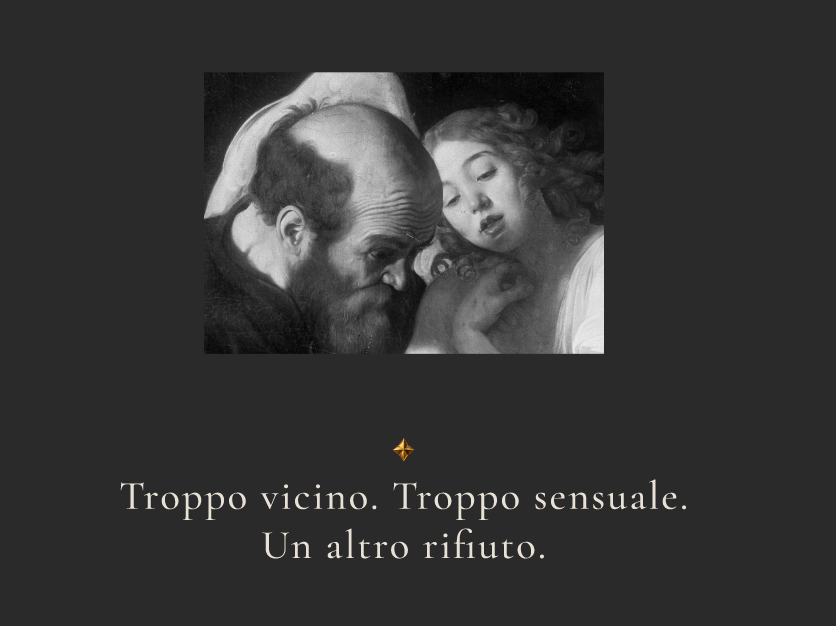 | 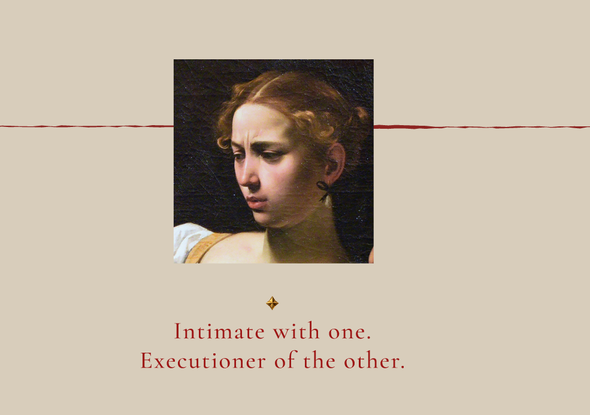 |

*Preview screenshots supplied by the author on 25 October 2026, reproduced without alterations.*

## Focused helpers

Opening a helper replaces the surrounding gallery with the selected image, the chapter background and a gold-bordered explanation. The interaction keeps attention on one detail and avoids overlapping text from neighbouring artworks.

### LIGHT — Basket of Fruit · Polish

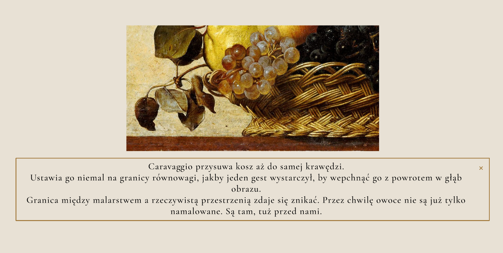

### BLOOD — The Beheading of Saint John the Baptist · German

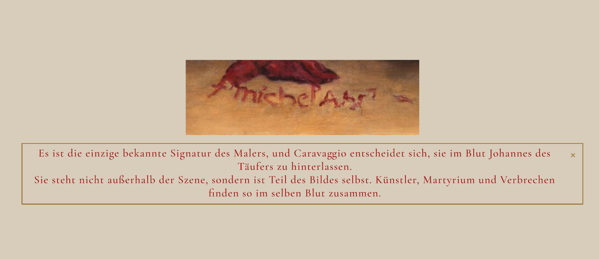

### BLOOD — Saint Jerome · Japanese

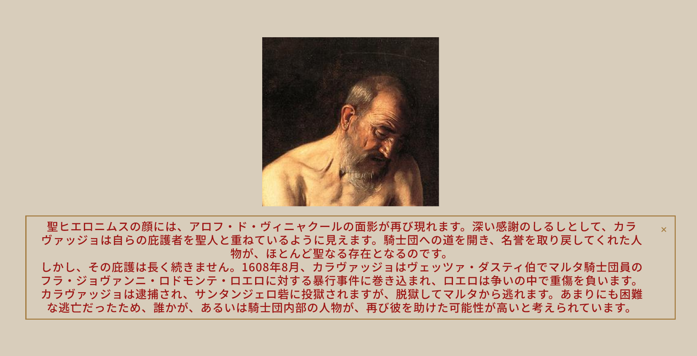

The prototype uses dedicated overlay frames, explicit close targets and language-specific text panels. [Read the implementation notes](docs/prototype-notes.md).

### Button feedback

The gold helper button shows a warm reflection when the pointer passes over it. Mouse-enter and mouse-leave events control the visual response independently of the click that opens the helper.

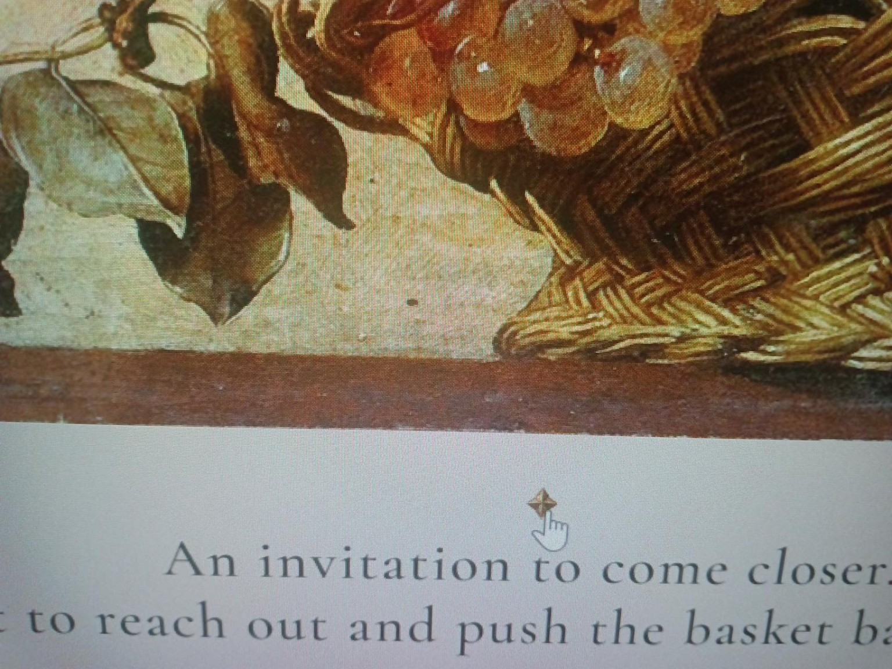

## Eight languages, stored in the prototype

**Italian · English · German · French · Simplified Chinese · Japanese · Polish · Dutch**

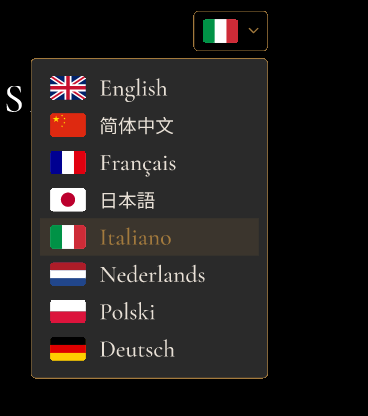

The current content archive contains **20 details**, each with a short anecdote and a longer helper in eight languages: **320 text entries**. Translations are saved in Figma; selecting a language does not call a translation API.

The author’s Italian texts are the source of truth. The archive preserves the current source texts and translations verbatim.

[Read the complete multilingual text archive](docs/translations/caravaggio-anecdotes-and-helpers-8-languages.txt)

## Academic context

| | |
| --- | --- |
| **Author** | Alessandro Benevelli |
| **University** | [Open Institute of Technology — OPIT](https://www.opit.com/) |
| **Degree** | Bachelor of Science in Computer Science |
| **Course** | COMP-2002 — Web Development, Fall 2026 |
| **Professor** | Filip Biały |
| **Current deliverable** | Assessment 1: Web Development Project Prototype |

The same project is planned to continue through all three course assessments.

| Milestone | Deliverable | Deadline |
| --- | --- | --- |
| **Assessment 1** | Detailed interactive prototype | 27 October 2026 |
| **Assessment 2** | Working web development project | 1 December 2026 |
| **Assessment 3** | Complete web development project | 5 January 2027 |

[Course requirements](docs/course-requirements.md) · [Full work plan](docs/work-plan-2026-2027.md)

## From prototype to website

The next phase will translate the design into HTML, CSS and JavaScript. These behaviours are planned for the website and are not implemented in the current Figma prototype:

| Planned improvement | Intended behaviour |
| --- | --- |
| **Vertical scroll snapping and chapter entry** | Settle on LIGHT, SHADOW or BLOOD and position that chapter’s horizontal track on its title |
| **Horizontal scroll snapping** | Let paintings and details settle near the centre of the viewport |
| **Visible horizontal scrollbar** | Provide an explicit control and position indicator for each gallery, alongside the side previews |
| **Responsive layouts** | Adapt artwork, spacing and explanation panels to desktop, tablet and mobile |
| **Accessible helper dialogs** | Support keyboard input, Escape, focus management and background scroll locking |
| **Local language resources** | Keep anecdotes and explanations in the same selected language using stored translations |
| **Media handling** | Optimise loading and provide playback controls and autoplay-blocked handling |
| **Reduced motion** | Respect motion preferences when implementing animated navigation |

Vertical snapping and horizontal title positioning are separate concerns: snapping to a chapter vertically does not automatically reset its horizontal track. The website will coordinate both, using CSS scroll snapping and JavaScript where needed. This coordinated behaviour is a limitation of the current prototype, recorded for the implementation phase.

Hosting on Amazon S3 and CloudFront is planned for the working website.

A later phase proposes a gallery-style guestbook using API Gateway, Lambda and DynamoDB, with submission moderation through Amazon Nova on Amazon Bedrock. These are planned project choices; they are not implemented in the Figma prototype or required technologies prescribed by the syllabus.

[Detailed behaviour and prototype limitations](docs/prototype-notes.md#9-figma-behaviour-versus-planned-website-behaviour) · [Full work plan](docs/work-plan-2026-2027.md)

## Repository guide

| File | Purpose |
| --- | --- |
| [Prototype notes](docs/prototype-notes.md) | Navigation, helpers, language selection, verification and Figma limitations |
| [Course requirements](docs/course-requirements.md) | Academic context, assessment milestones and submission requirements |
| [Work plan](docs/work-plan-2026-2027.md) | Development phases from October 2026 to January 2027 |
| [Translation archive](docs/translations/caravaggio-anecdotes-and-helpers-8-languages.txt) | Italian anecdotes and helpers alongside all seven translations |
| [Credits](docs/credits.md) | Authorship, visual references and media sources |
| [Screenshots](assets/screenshots) | Current prototype captures used in this README |

All project documentation is in English. The translation archive retains its multilingual content.

---

Designed and developed as an independent student project by **Alessandro Benevelli** for COMP-2002 at OPIT. University and course references identify the academic context; they do not imply institutional endorsement.

