

# CARAVAGGIO
### LIGHT · SHADOW · BLOOD

**An immersive journey through Caravaggio’s paintings, life and contradictions.**

[**Open the website**](https://dgn3qdx78alyc.cloudfront.net/) · [**Open the Assessment 1 Figma prototype**](https://www.figma.com/proto/gVNoq7JkoidWp73WNVsCdA/CARAVAGGIO-%E2%80%94-LIGHT---SHADOW---BLOOD-project?node-id=2251-2&p=f&t=mBbglGlgnijfBiDA-0&scaling=min-zoom&content-scaling=fixed&page-id=0%3A1&starting-point-node-id=2251%3A2) · [Design & interaction notes](docs/prototype-notes.md) · [Project roadmap](docs/work-plan-2026-2027.md)

**Assessment 2 website · COMP-2002 Web Development · OPIT**

**A non-commercial university project, created for the COMP-2002 Web Development course at Open Institute of Technology (OPIT), as a tribute to the art of Caravaggio.**

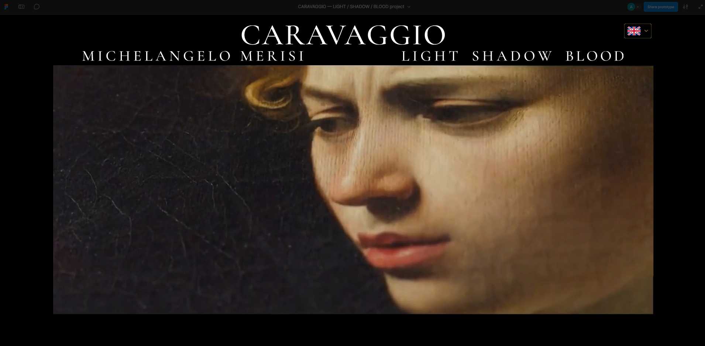

## The experience

A painting first. A detail next. A story when you choose to look closer.

This project explores Caravaggio through three visual chapters: **LIGHT**, **SHADOW** and **BLOOD**. Full paintings establish context; selected details and short anecdotes invite visitors to pause, interpret and discover the person behind the work. Gold helper buttons reveal longer explanations without crowding the gallery.

The experience uses contrasting backgrounds, expressive typography and generous space around the artwork. Visitors move horizontally within each chapter and vertically between chapters.

## Explore the website

1. Open the [website](https://dgn3qdx78alyc.cloudfront.net/) in a browser.
2. Choose a language using the selector on the opening screen.
3. Scroll vertically between chapters and horizontally to explore their paintings and details.
4. Select a gold helper button to focus on an image and its explanation.
5. Close the explanation with **×**, Escape or a click outside its gold-bordered text panel.

**Current stage - Assessment 2, working website.** Implemented in HTML, CSS and JavaScript and deployed on Amazon S3 and CloudFront. The repository contains the website source, its content and technical documentation. The Assessment 1 Figma prototype and submitted report are retained as earlier project deliverables.

## Assessment 1 prototype structure

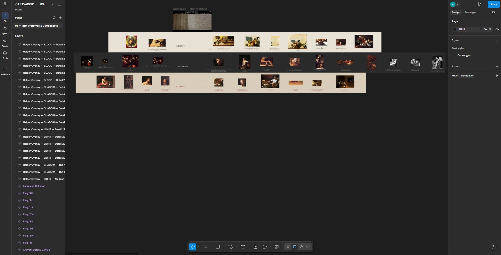

The prototype uses **one vertically scrolling main frame** to connect the opening screen and the three chapters. Each chapter has a **horizontal scrolling viewport** containing one extended frame with its title, artworks, details and captions. This nested structure creates a continuous vertical journey with independent horizontal exploration.

Reusable components, text styles and variables keep controls and presentation consistent. Complete paintings provide title, year and collection/location; selected crops add a short anecdote and a gold button for an optional explanation.

The main technical decisions are:

- **Focused overlays:** opening a helper covers the surrounding gallery and centres the crop and explanation on the chapter background.
- **Explicit close targets:** × and clicks outside the gold-bordered panel dismiss the helper; clicking its text keeps it open.
- **One opening per click:** each live button has one overlay-opening action, preventing stacked copies that require repeated closing clicks.
- **Independent hover feedback:** mouse-enter and mouse-leave events toggle the existing warm reflection through a Boolean variable, without switching component variants.
- **Stored translations:** the selector updates bound text variables for anecdotes; helper opening actions display the corresponding saved language panel. Both follow the same selected language.
- **Language-aware fitting:** font size, wrapping and panel placement accommodate different text lengths and writing systems without rewriting the content.

## Design references - DATALAND

**[dataland.art](https://dataland.art/), the website of DATALAND, the Museum of AI Arts in Los Angeles, was a direct design reference for this project.** The large opening video and partially visible neighbouring content informed the presentation of Caravaggio’s paintings and storytelling.

| Reference | Design characteristic | Application to Caravaggio |
| --- | --- | --- |
| **Near-full-screen opening video** | Moving imagery dominates the opening view and establishes an atmosphere before visitors begin exploring | A large introductory video occupies most of the opening screen beneath the Caravaggio title, introducing the mood of LIGHT, SHADOW and BLOOD |
| **Neighbouring content visible at the sides** | A central item remains the focus while fragments at the edges reveal that more content is available | Paintings, details and captions remain partly visible beside the central item, inviting horizontal scrolling through each chapter |

### An immersive opening video

The opening video’s **near-full-screen presentation is explicitly inspired by DATALAND**. Adapted to an introductory montage about Caravaggio, with the project title and language selector framing the experience.

| DATALAND - opening video reference | Caravaggio - opening video in the prototype |
| --- | --- |
| 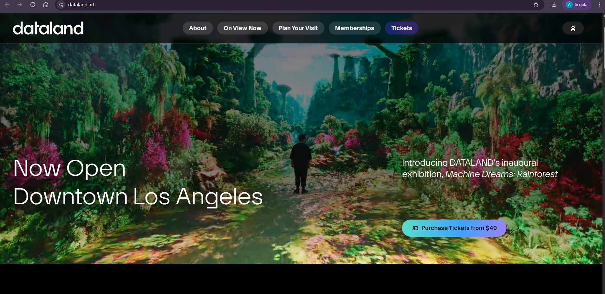 |  |

This reference concerns the **presentation and visual impact of the video**. The source credits for the Caravaggio montage are documented separately in [Credits](docs/credits.md#introductory-audiovisual-material).

### Making horizontal exploration intuitive

Artworks and captions are deliberately **partially visible at the left and right edges** of the gallery. These glimpses show that the composition continues beyond the viewport and invite visitors to scroll sideways. The central detail stays in focus while neighbouring images and text act as navigation cues.

This design choice was inspired by **[dataland.art](https://dataland.art/), the website of DATALAND, the Museum of AI Arts in Los Angeles**. In particular, its presentation of a central item with neighbouring content visible at the sides informed the horizontal exploration in this project.

| Caravaggio prototype - neighbouring artworks visible at the edges | Design reference - dataland.art |
| --- | --- |
| 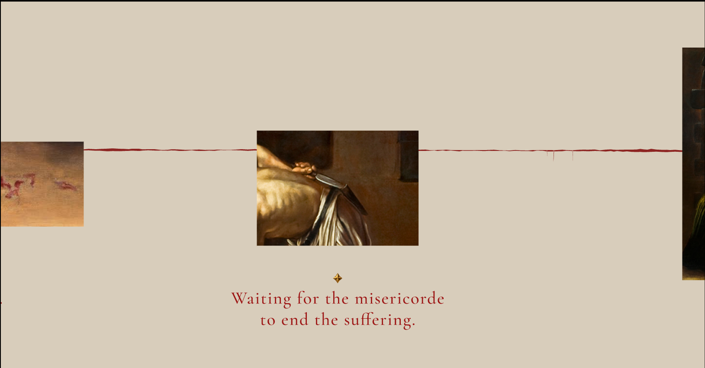 | 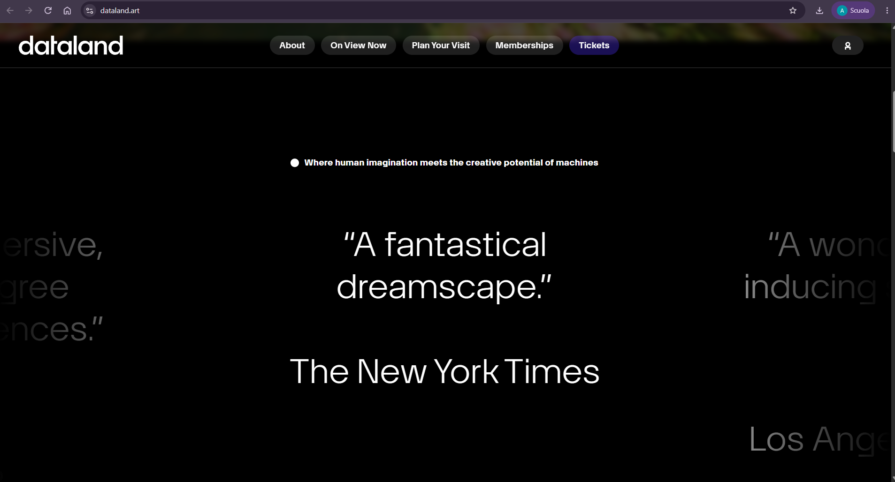 |

The website uses a dot navigation bar, centred scroll snapping and mouse dragging for horizontal exploration. A slim horizontal scrollbar is available in the smallest windows when the dot bar would overlap the content.

[Read the detailed architecture and implementation notes](docs/prototype-notes.md).

## Design references - Apple

**[Apple’s website](https://www.apple.com/it/) was another direct design reference.** Contrasting sections and centred images surrounded by empty space informed the chapter backgrounds and artwork presentation.

| Design characteristic | Application to Caravaggio |
| --- | --- |
| **Contrasting section backgrounds** | Distinct cream, charcoal and warm beige backgrounds separate LIGHT, SHADOW and BLOOD and give each chapter its own atmosphere |
| **Centred images with empty space around them** | Paintings and selected details become the visual focus, with restrained backgrounds and generous space around them |

| Apple reference | Caravaggio chapter backgrounds |
| --- | --- |
| 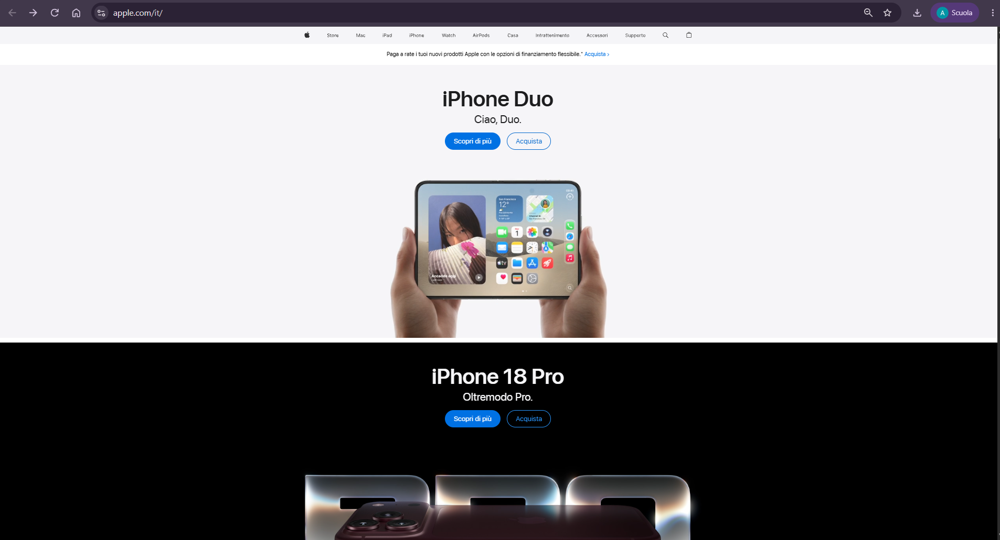 | 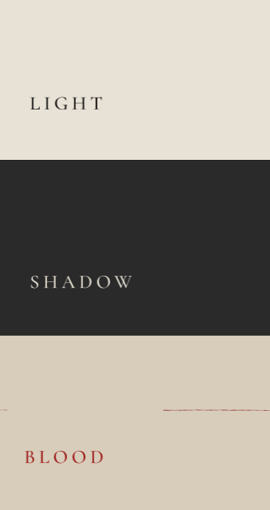 |

### Why this connects to Caravaggio

Caravaggio’s reduced backgrounds concentrate attention on figures. This characteristic connects with the centred imagery and restrained backgrounds used in the website references.

Applied in the prototype through restrained backgrounds, centred imagery and space around the artworks. The contrasting chapters and image spacing support the focus on paintings and selected details.

## Three chapters

| LIGHT | SHADOW | BLOOD |
| --- | --- | --- |
| Light, matter and the presence of the sacred. | Human imperfection, scandal and the painter’s personal struggles. | Violence, mortality and the search for protection. |
| [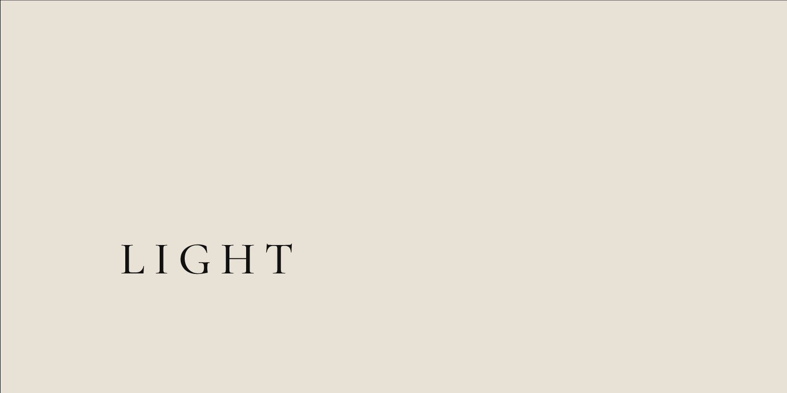](assets/screenshots/light-chapter.png) | [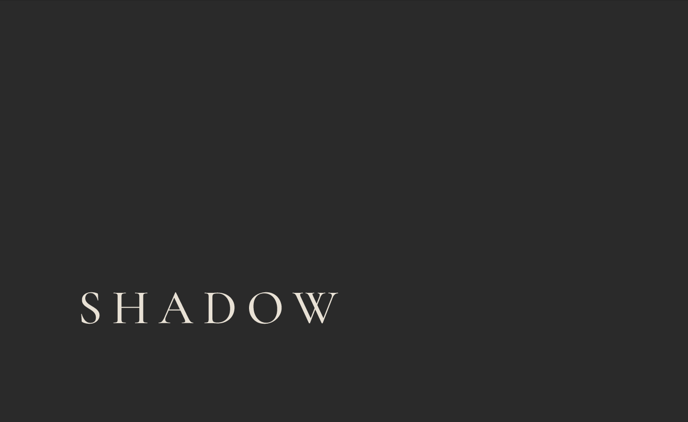](assets/screenshots/shadow-chapter.png) | [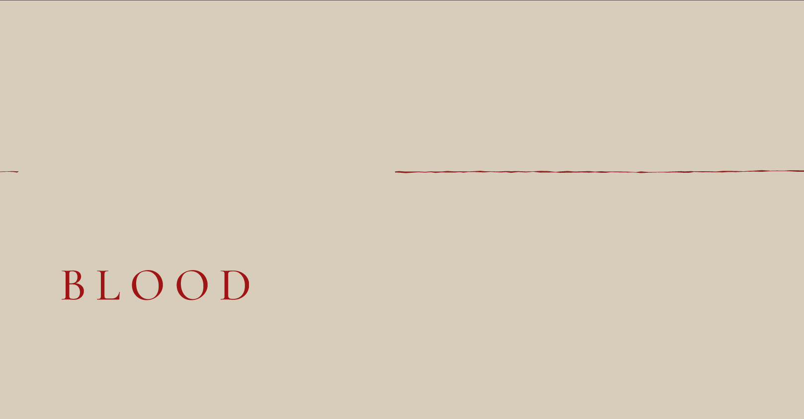](assets/screenshots/blood-chapter.png) |

### Language selection across anecdotes and helpers

The language selector applies to both the **short anecdotes beneath the artwork details** and the **longer explanations opened through the gold helper buttons**. Selecting a language displays the corresponding stored translations throughout the prototype, so visitors can explore both levels of storytelling in their chosen language.

The examples below show anecdotes in Italian and English; the helper screenshots that follow show the longer explanations in Polish, German and Japanese. All eight language versions are saved in Figma, without runtime translation API calls.

| SHADOW - Saint Matthew and the Angel · Italian | BLOOD - Judith Beheading Holofernes · English |
| --- | --- |
| 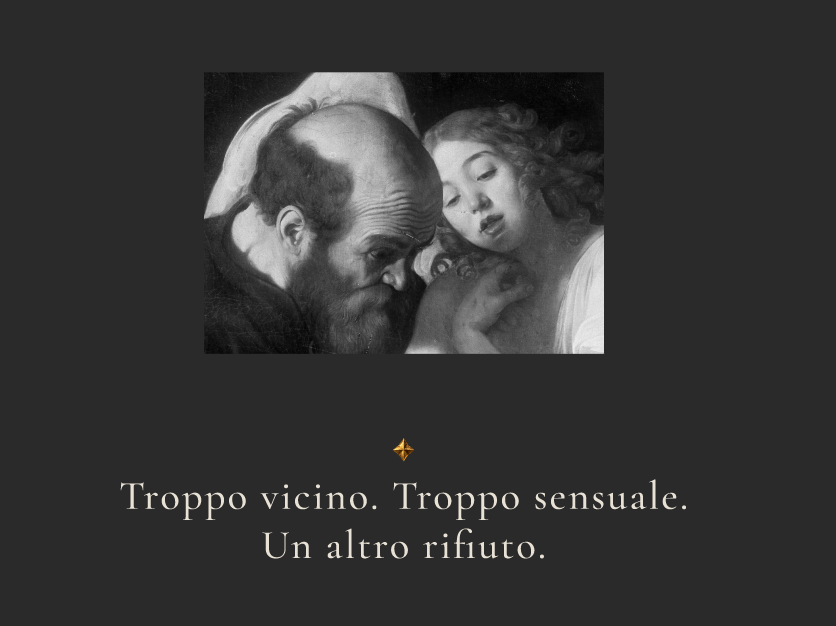 | 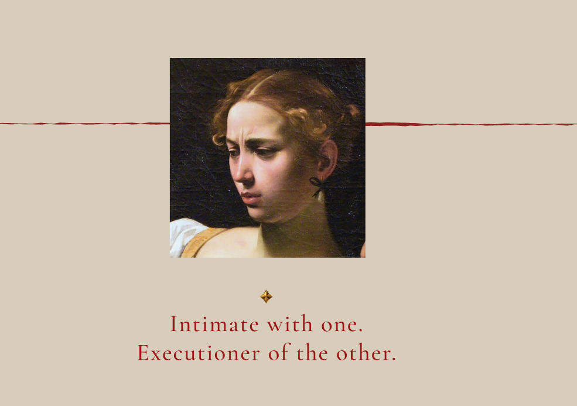 |

*These screenshots show the Assessment 1 prototype as captured on 25 October 2026.*

## Focused helpers

Opening a helper replaces the surrounding gallery with the selected image, the chapter background and a gold-bordered explanation. The interaction keeps attention on one detail and avoids overlapping text from neighbouring artworks.

### LIGHT - Basket of Fruit · Polish

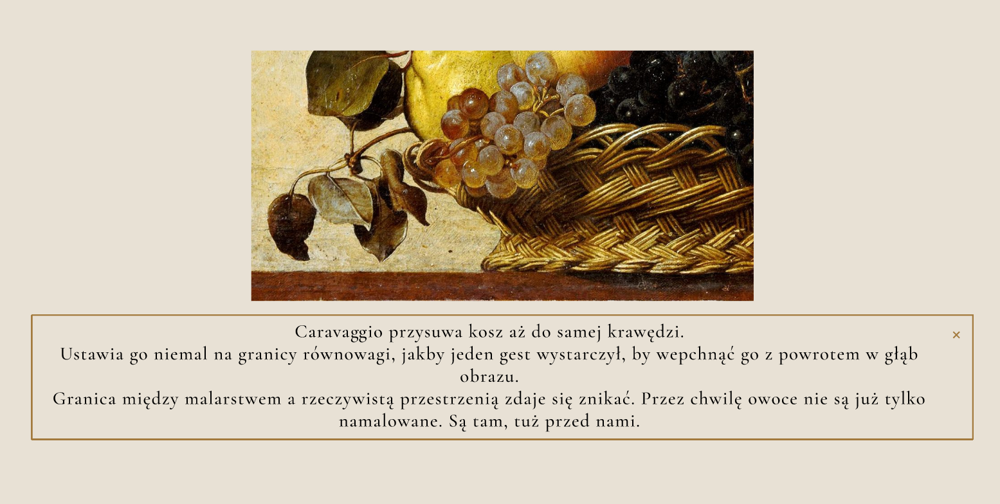

### BLOOD - The Beheading of Saint John the Baptist · German

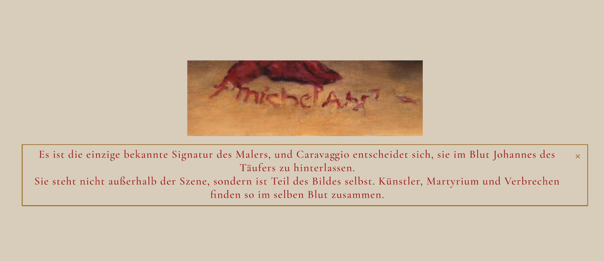

### BLOOD - Saint Jerome · Japanese

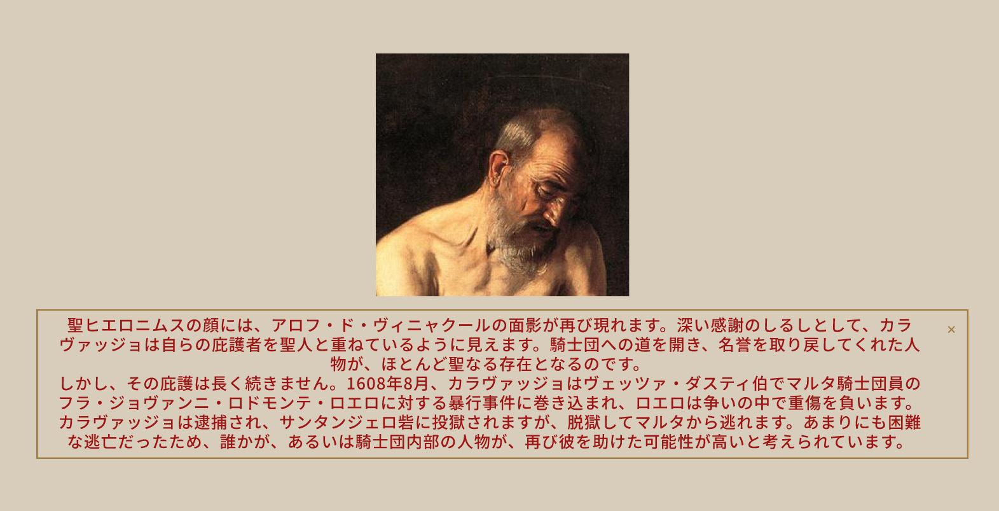

The screenshots show the prototype’s overlay frames. In the website, the explanation opens in a native HTML `dialog`, with keyboard support and focus returning to the opening button when it closes. [Read the prototype notes](docs/prototype-notes.md) and [the WHATWG HTML Living Standard and W3C WCAG 2.2 Accessibility review](docs/whatwg-html-living-standard-and-w3c-wcag-2.2-accessibility.md).

### Button feedback

The website’s gold Medusa buttons and explanation close control brighten with a gold glow when hovered or focused with the keyboard. The image below records the button feedback in the Assessment 1 prototype.

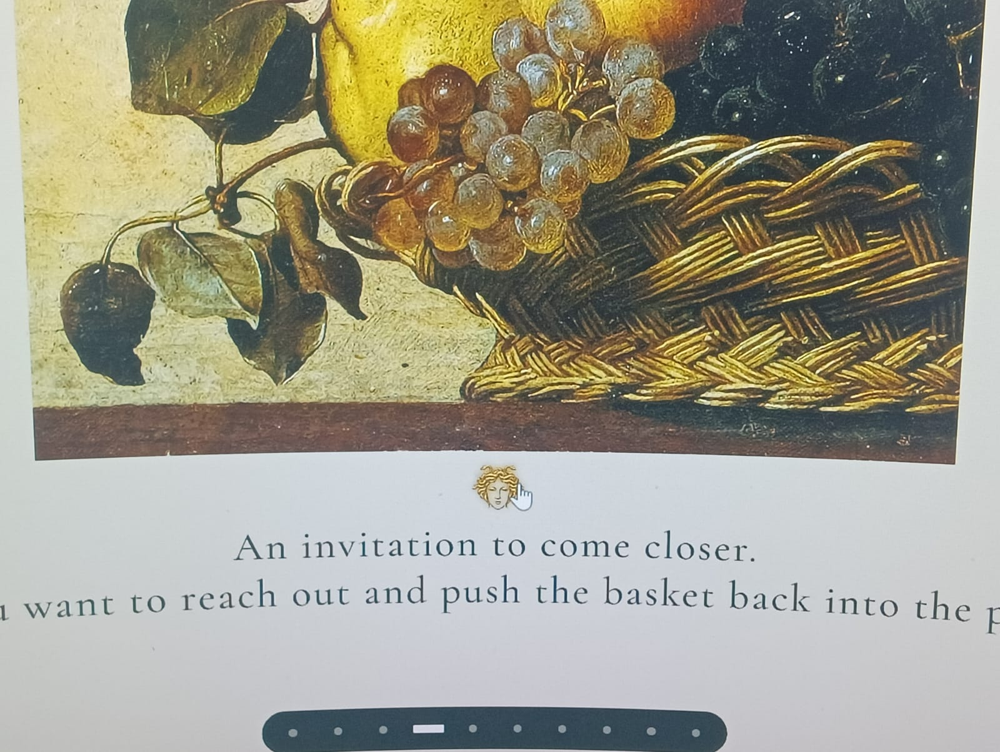

## Eight languages

**Italian · English · German · French · Simplified Chinese · Japanese · Polish · Dutch**

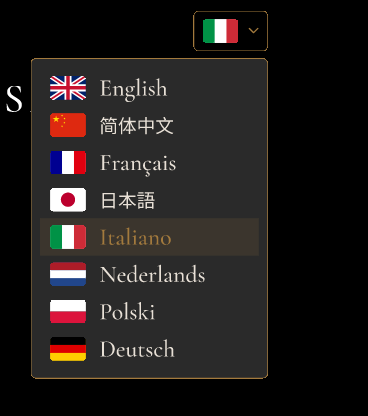

The website content archive contains **20 details**, each with a short anecdote and a longer explanation in eight languages, giving **320 text entries**. The translations are stored in JSON files. The language selector loads the saved text and updates the reading language of translated content and controls.

Italian anecdotes and explanations were written for the project. The website uses [the multilingual content archive](data/texts.json), [artwork descriptions and gallery labels](data/whatwg-screen-reader-artwork-descriptions.json), and [screen-reader control labels](scripts/whatwg-screen-reader-controls.js).

[Read the Assessment 1 multilingual text archive](docs/translations/caravaggio-anecdotes-and-helpers-8-languages.txt)

## Academic context

| | |
| --- | --- |
| **Name** | Alessandro Benevelli |
| **University** | [Open Institute of Technology - OPIT](https://www.opit.com/) |
| **Degree** | Bachelor of Science in Computer Science |
| **Course** | COMP-2002 - Web Development, Fall 2026 |
| **Professor** | Filip Biały |
| **Current deliverable** | Assessment 2 - Working web development project |

The project spans all three course assessments.

| Milestone | Deliverable | Deadline |
| --- | --- | --- |
| **Assessment 1** | Detailed interactive prototype | 27 October 2026 |
| **Assessment 2** | Working web development project | 1 December 2026 |
| **Assessment 3** | Complete web development project | 5 January 2027 |

[Full work plan](docs/work-plan-2026-2027.md)

## Website implementation

Implemented in HTML, CSS and JavaScript. Hosted on Amazon S3 through CloudFront with HTTPS.

| Feature | Implementation |
| --- | --- |
| **Chapter navigation** | Vertical scroll snapping centres chapters and restores their horizontal position to the section title |
| **Gallery navigation** | Horizontal snapping, mouse dragging, dot buttons and a scrollbar for the smallest windows |
| **Responsive layouts** | Artwork, captions and navigation adapt to desktop, tablet and smaller windows |
| **Explanation dialogs** | Native HTML dialogs with Escape handling, focus restoration and scrollable explanation text |
| **Eight languages** | Stored translations for section titles, anecdotes, explanations, artwork descriptions and control labels |
| **Video controls** | Play, pause and sound controls for the introductory montage |
| **Reduced motion** | Navigation respects the browser’s reduced-motion preference |

The [WHATWG HTML Living Standard and W3C WCAG 2.2 Accessibility review](docs/whatwg-html-living-standard-and-w3c-wcag-2.2-accessibility.md) records the HTML implementation and accessibility checks. The [development log](docs/development-log.md) records the project’s progress.

A later phase proposes a gallery-style guestbook using API Gateway, Lambda and DynamoDB, with submission moderation through Amazon Nova on Amazon Bedrock. These are planned project choices; they are not implemented in the Figma prototype or required technologies prescribed by the syllabus.

[Detailed behaviour and prototype limitations](docs/prototype-notes.md#9-figma-behaviour-versus-planned-website-behaviour) · [Full work plan](docs/work-plan-2026-2027.md)

## Repository guide

| File | Purpose |
| --- | --- |
| [Assessment 1 - submitted report](docs/Alessandro_Benevelli_COMP-2002_Assessment_1.pdf) | Submitted prototype report, preserved in its original form with the university APA-format cover |
| [Prototype notes](docs/prototype-notes.md) | Navigation, helpers, language selection, verification and Figma limitations |
| [Work plan](docs/work-plan-2026-2027.md) | Development phases from October 2026 to January 2027 |
| [Translation archive](docs/translations/caravaggio-anecdotes-and-helpers-8-languages.txt) | Italian anecdotes and helpers alongside all seven translations |
| [Credits](docs/credits.md) | Project contribution, visual references and media sources |
| [Screenshots](assets/screenshots) | Assessment 1 prototype captures and design references |
| [WHATWG HTML Living Standard and W3C WCAG 2.2 Accessibility](docs/whatwg-html-living-standard-and-w3c-wcag-2.2-accessibility.md) | HTML implementation and accessibility checks |
| [Development log](docs/development-log.md) | Website development milestones |

All project documentation is in English. The translation archive retains its multilingual content.

## Opening video and music credits

The introductory video was assembled by selecting, trimming and joining scenes from **_Caravaggio - L’anima e il sangue_** (Italian theatrical release: 2018), a **Sky / Sky Arte and Magnitudo Film** production, directed by **Jesus Garces Lambert**, with cinematography by **Massimiliano Gatti**, distributed by **Nexo Digital**. The montage uses selected and re-edited excerpts. The original footage is credited to the film’s creators.

The background music used in the introductory montage is **“Experience” by Ludovico Einaudi**, from **_In a Time Lapse_ (2013), Decca Records**.

Film sources: [Sky’s production announcement](https://tg24.sky.it/spettacolo/cinema/2017/09/21/caravaggio-l-anima-e-il-sangue), [Cinematografo’s full credits](https://www.cinematografo.it/film/caravaggio-lanima-e-il-sangue-ah8cqdsh) and [Nexo Digital’s film presentation](https://www.nexostudios.it/movie/caravaggio-lanima-e-il-sangue-replica/).

Music source: [Ludovico Einaudi’s official album page](https://ludovicoeinaudi.com/in-a-time-lapse/). The documentary’s original score by Matteo Curallo and the Einaudi track selected for this montage are credited separately.

The montage forms part of a **non-commercial university project for COMP-2002 at OPIT, created as a tribute to Caravaggio’s art**. Original footage and music are credited to their respective creators and rights holders.

[Detailed film and music credits, with source references](docs/credits.md#introductory-audiovisual-material).

## Copyright and usage

Copyright © 2026 Alessandro Benevelli. All rights reserved.

This repository contains an original academic project developed for COMP-2002 Web Development at the Open Institute of Technology (OPIT).

No permission is granted to reproduce, redistribute, modify or commercially exploit the original project materials without prior authorization, except as permitted by applicable law.

Third-party artworks, reproductions, film footage and music remain the property of their respective rights holders and are subject to their own licensing terms.

See [LICENSE](LICENSE) and [LICENSING.md](LICENSING.md).

---

Designed and developed for COMP-2002 at OPIT. University and course references identify the academic context; they do not imply institutional endorsement.
