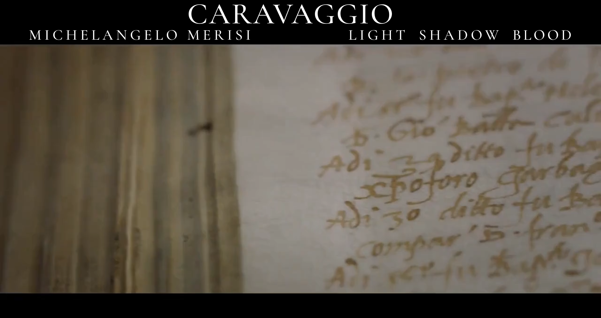
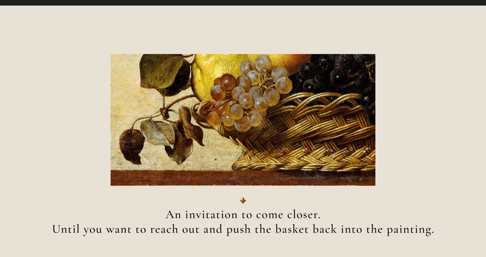
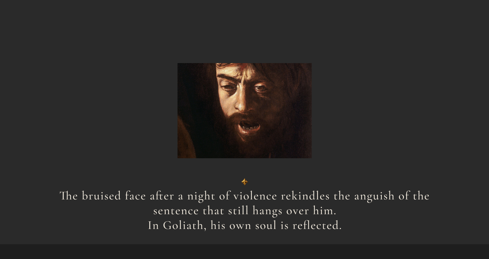
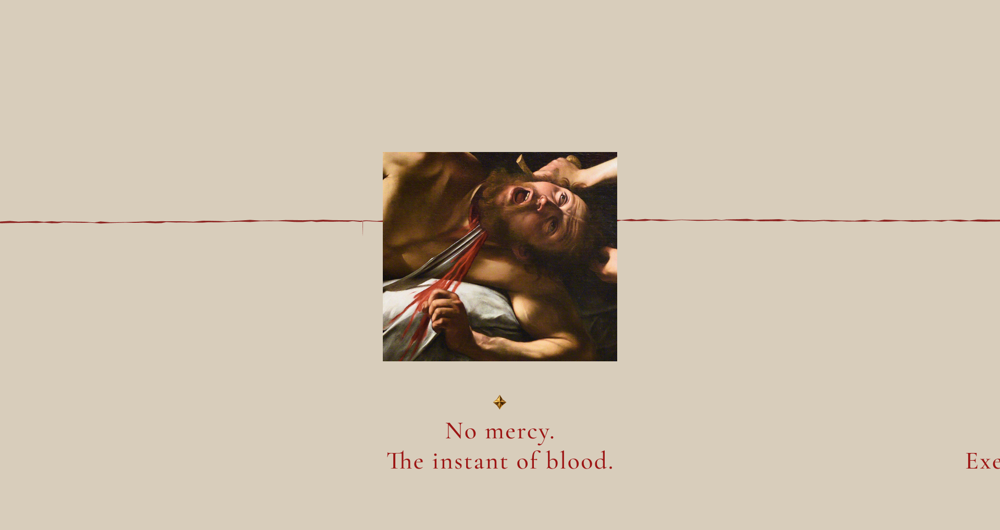
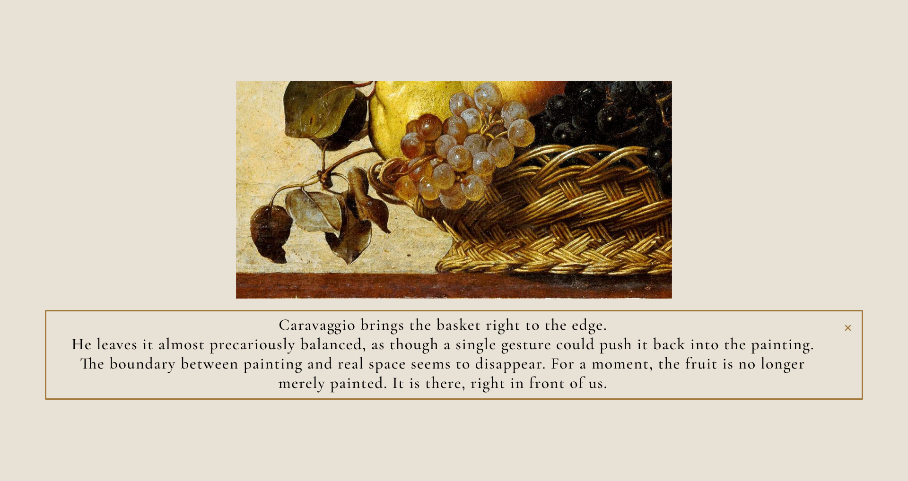
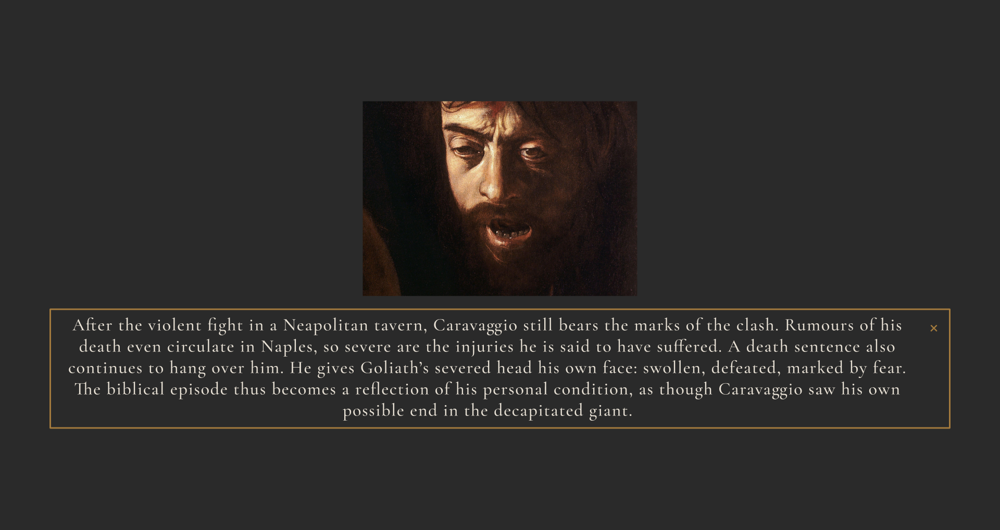
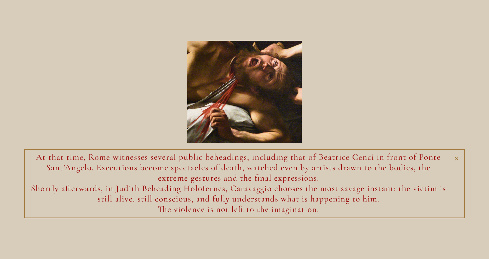

# CARAVAGGIO
### LIGHT · SHADOW · BLOOD

**An immersive journey through Caravaggio’s paintings, life and contradictions.**

[Explore the interactive prototype](https://www.figma.com/proto/gVNoq7JkoidWp73WNVsCdA/CARAVAGGIO-%E2%80%94-LIGHT---SHADOW---BLOOD-project?node-id=2251-2&p=f&scaling=min-zoom&content-scaling=fixed&page-id=0%3A1&starting-point-node-id=2251%3A2) · [Design & interaction notes](docs/prototype-notes.md) · [Project roadmap](docs/work-plan-2026-2027.md)

**Figma prototype · COMP-2002 Web Development · OPIT**

## The experience

A painting first. A detail next. A story when you choose to look closer.

This project explores Caravaggio through three visual chapters: **LIGHT**, **SHADOW** and **BLOOD**. Full paintings establish context; selected details and short anecdotes invite visitors to pause, interpret and discover the person behind the work. Gold helper buttons reveal longer explanations without crowding the gallery.

The experience uses contrasting backgrounds, expressive typography and generous space around the artwork. Visitors move horizontally within each chapter and vertically between chapters.

## Explore the prototype

1. Open the [interactive Figma prototype](https://www.figma.com/proto/gVNoq7JkoidWp73WNVsCdA/CARAVAGGIO-%E2%80%94-LIGHT---SHADOW---BLOOD-project?node-id=2251-2&p=f&scaling=min-zoom&content-scaling=fixed&page-id=0%3A1&starting-point-node-id=2251%3A2) on a desktop browser.
2. Choose a language using the selector on the opening screen.
3. Scroll vertically between chapters and horizontally to explore their paintings and details.
4. Select a gold helper button to focus on an image and its explanation.
5. Close the helper with **×** or a click outside its gold-bordered text panel, within the prototype viewport.

**Current stage: Assessment 1 — interactive prototype.** This repository documents the design and its content. Website implementation, responsive layouts, browser scroll snapping and AWS services belong to later phases.

## Three chapters

| LIGHT | SHADOW | BLOOD |
| --- | --- | --- |
| Light, matter and the presence of the sacred. | Human imperfection, scandal and the painter’s personal struggles. | Violence, mortality and the search for protection. |
|  |  |  |

*Screenshots exported from the current Figma design on 25 October 2026. Gallery images are viewport-sized crops of the horizontal design tracks.*

## Focused helpers

Opening a helper replaces the surrounding gallery with the selected image, the chapter background and a gold-bordered explanation. The interaction keeps attention on one detail and avoids overlapping text from neighbouring artworks.

View SHADOW and BLOOD helper examples

### SHADOW — David with the Head of Goliath

### BLOOD — Judith Beheading Holofernes

The prototype uses dedicated overlay frames, explicit close targets and language-specific text panels. [Read the implementation notes](docs/prototype-notes.md).

## Eight languages, stored in the prototype

**Italian · English · German · French · Simplified Chinese · Japanese · Polish · Dutch**

The current content archive contains **20 details**, each with a short anecdote and a longer helper in eight languages: **320 text entries**. Translations are saved in Figma; selecting a language does not call a translation API.

The author’s Italian texts are the source of truth. The archive preserves the current source texts and translations verbatim.

[Read the complete multilingual text archive](docs/translations/caravaggio-anecdotes-and-helpers-8-languages.txt)

## Academic context

| | |
| --- | --- |
| **Author** | Alessandro Benevelli |
| **University** | [Open Institute of Technology — OPIT](https://www.opit.com/) |
| **Degree** | Bachelor of Science in Computer Science |
| **Course** | COMP-2002 — Web Development, Fall 2026 |
| **Professor** | Filip Biały |
| **Current deliverable** | Assessment 1: Web Development Project Prototype |

The same project is planned to continue through all three course assessments.

| Milestone | Deliverable | Deadline |
| --- | --- | --- |
| **Assessment 1** | Detailed interactive prototype | 27 October 2026 |
| **Assessment 2** | Working web development project | 1 December 2026 |
| **Assessment 3** | Complete web development project | 5 January 2027 |

[Course requirements](docs/course-requirements.md) · [Full work plan](docs/work-plan-2026-2027.md)

## From prototype to website

The next phase will translate the design into HTML, CSS and JavaScript, with responsive layouts, accessible controls, local language resources and scroll snapping. Hosting on Amazon S3 and CloudFront is planned for the working website.

A later phase proposes a gallery-style guestbook using API Gateway, Lambda and DynamoDB, with submission moderation through Amazon Nova on Amazon Bedrock. These are planned project choices; they are not implemented in the Figma prototype or required technologies prescribed by the syllabus.

## Repository guide

| File | Purpose |
| --- | --- |
| [Prototype notes](docs/prototype-notes.md) | Navigation, helpers, language selection, verification and Figma limitations |
| [Course requirements](docs/course-requirements.md) | Academic context, assessment milestones and submission requirements |
| [Work plan](docs/work-plan-2026-2027.md) | Development phases from October 2026 to January 2027 |
| [Translation archive](docs/translations/caravaggio-anecdotes-and-helpers-8-languages.txt) | Italian anecdotes and helpers alongside all seven translations |
| [Credits](docs/credits.md) | Authorship, visual references and media sources |
| [Screenshots](assets/screenshots) | Current prototype captures used in this README |

All project documentation is in English. The translation archive retains its multilingual content.

---

Designed and developed as an independent student project by **Alessandro Benevelli** for COMP-2002 at OPIT. University and course references identify the academic context; they do not imply institutional endorsement.

